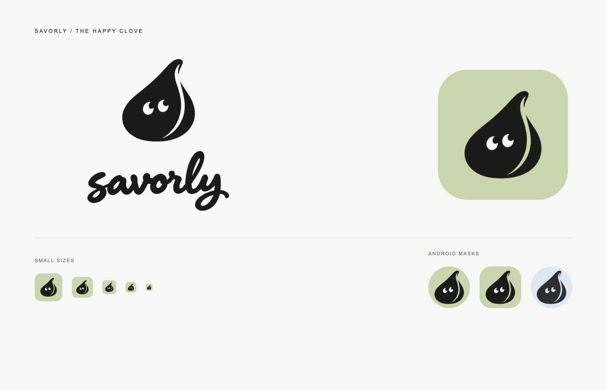

# Savorly — The Happy Clove

The selected identity pairs an asymmetric garlic-clove character with a flowing, hand-lettered
`savorly` wordmark. The crescent eyes and curved clove separation remain readable at small sizes.
Charcoal (`#1B1C1A`), cream (`#F7F8F5`), and sage (`#CAD5AE`) come from the app's existing brand palette.



## Artwork and use

- `apps/mobile/assets/brand-artwork.json` is the shared vector source for the app and icon renderer.
- `BrandMark` and `BrandWordmark` in `src/components/Brand.tsx` render it with the existing
  `react-native-svg` dependency. The wordmark is outlined artwork and requires no additional font.
- The desktop home link, sign-in dialog, and signed-out kitchen use the new identity. Cooking
  controls and recipe placeholders keep their functional Lucide icons.
- `brand-mark.svg` and `brand-wordmark.svg` are transparent exports. `brand.svg` is the square
  app icon with its sage background.
- The transparent generated masters and their prompts are in `docs/brand/`. They were refined
  with built-in image generation from the selected concept, then traced to clean vector paths.
  Production rendering does not use those raster masters or require an image-generation service.

## Regenerate platform assets

After installing the mobile app's existing dependencies, run from the repository root:

```sh
npm run brand
```

The renderer uses installed Google Chrome locally and Playwright Chromium in CI. It emits the
SVG exports and these PNGs:

| Asset                         | Size        | Use                                                                   |
| ----------------------------- | ----------- | --------------------------------------------------------------------- |
| `icon.png`                    | 1024 × 1024 | Opaque iOS / default app icon                                         |
| `favicon.png`                 | 64 × 64     | Browser icon, with a slightly larger clove                            |
| `android-icon-foreground.png` | 512 × 512   | Transparent adaptive foreground                                       |
| `android-icon-monochrome.png` | 512 × 512   | Alpha-only themed icon with eye and clove cutouts                     |
| `splash-icon.png`             | 1024 × 1024 | Transparent splash artwork, available for future splash configuration |

Android's adaptive background in `app.json` must match the sage brand color; the renderer checks
this. The adaptive clove is smaller than the default icon to fit the guaranteed 66/108 safe circle.
See [Android's adaptive icon guidelines](https://developer.android.com/develop/ui/compose/system/icon_design_adaptive).
Launcher icon changes require a new native build; updating JavaScript alone does not replace the
installed launcher icon. See [Expo's icon documentation](https://docs.expo.dev/develop/user-interface/splash-screen-and-app-icon/).
